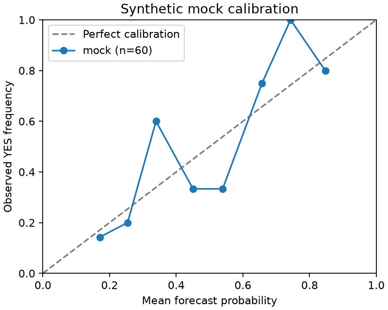

# LLM 预测离线评估 v0

ARB-11 的离线评估管线已用 **60 道合成二元题 + mock 预测器**跑通。
结果不能证明 LLM 预测能力、Polymarket 市场优势或可交易收益。真实市场 / 模型评估仍阻塞。

## 本次结果

固定 seed=11；两种 mock 模型 `mock-a` / `mock-b`，各采样 2 次，算术平均得到每题一个 p；共 240 条预测。
题目与结果由 `arb_research.forecast.demo.cohort` 确定性生成，q 是合成报价。

| 指标 | mock / 合成题结果 |
| --- | ---: |
| 题数 | 60 |
| Brier | 0.181823368 |
| 同时点市场基准 Brier | 0.178475635 |
| Log loss（自然对数） | 0.547467805 |
| 同时点市场基准 Log loss | 0.548169530 |
| Brier 优势（市场损失 − 模型损失） | −0.003347733 |
| 95% 配对 bootstrap 区间 | [−0.012285486, 0.007509748] |
| proper betting 扣费后 PnL | −4.327956 pUSD |
| 1/4 Kelly 扣费后 PnL | +34.536939 pUSD |

优势为正才表示比市场好；本例区间包含 0。JSON 保存逐题 p/q/y、报价时点、配置、校准点和排除原因。



曲线按 p 分成 10 个等宽桶，横轴是桶内平均预测，纵轴是实际 YES 频率；空桶为 null，不画为零。
样本量小，图用于核验流程。

## 重放

从仓库根目录执行（Python 3.12；核心模块只用标准库，不需要模型凭据、引擎或外网）：

```bash
PYTHONPATH=research/src python3.12 -m unittest discover -s research/tests -p test_forecast.py -v
PYTHONPATH=research/src python3.12 -m arb_research.forecast demo \
  --output docs/fixtures/llm-forecast-mock-v0.json \
  --db .state/forecasts.sqlite3 --count 60 --seed 11 --samples 2 --bootstrap 2000
```

JSON 不含运行 ID 或系统当前时间，同版本代码、参数和 Python 下可逐字节重现。
运行 ID、实际检索 / 预测时间在被 gitignore 的 SQLite 中。
生成校准图使用研究环境中的 Matplotlib（VectorBT 的依赖）：

```bash
cd research
uv run python scripts/plot_forecast.py ../docs/fixtures/llm-forecast-mock-v0.json \
  ../docs/fixtures/llm-forecast-mock-calibration-v0.png
```

现有研究环境可运行全部 `research/tests`；新增测试不访问外网。
接口测试 fixture 是依据当前官方文档整理的合成契约数据，**不是实网录制**；实网录制验证待网络恢复后补齐。

本次验证：完整 `PYTHONPATH=research/src python -m pytest research/tests -q` 为 **44 passed，11 subtests passed**，7 条已有依赖弃用警告；其中新增 19 项离线测试。
独立只读审查通过，并独立重算确认保存的 JSON 与指标一致；第二个 SQLite 运行的 JSON 逐字节重放一致。

## 只读题库采集

```bash
PYTHONPATH=research/src python3.12 -m arb_research.forecast collect \
  --output .state/settled-candidates.json --count 50 --max-pages 10
```

只访问以下固定 GET 接口，无 SDK 依赖、签名、账户、下单或资金接口：

- [Gamma markets](https://docs.polymarket.com/api-reference/markets/list-markets)：问题、条款、创建时间、YES/NO token 映射。
- [Data V2 resolutions](https://docs.polymarket.com/api-reference/markets/get-resolution-state)：核验 condition、RESOLVED 状态与 [1,0]/[0,1] payout。排除未结算和分摊 / 作废题，不以 endDate 当结算时间。
- [Data V2 price history](https://docs.polymarket.com/api-reference/markets/get-a-tokens-price-history)：按 YES token 分页保留历史价格；显式排除 `resolution_seconds=0` 的结算点。该点可能被 API 放在早于真实结算时间的桶边界，不能只过滤时间戳。

所有客户端共享同一个 NAS 用户 SQLite 令牌桶：5 req/s、burst 2，低于通用 9,000 req/10s。
429 / 指定 5xx / 网络失败最多尝试 4 次，指数退避；数字 Retry-After 至多等待 30 秒，更长则失败退出。
禁用环境 / 系统代理及重定向，403 不重试，不绕过地区限制。
后续数据层接入只需替换此采集边界，不影响评估器。

采集结果属于**候选题库**，默认不可直接历史评估：当前获取的条款快照带当前 `captured_at`，不会伪造为创建时间。
必须补充独立存档的预测时点前元数据及证据，并为每题指定 `forecast_at`。price 的 `available_at` 暂以交易时间为假设，JSON 明示这个假设；正式实验还需核验档案来源及数据修订风险。
不足 50 道合格题会失败并落库排除记录，不会悄悄缩小样本后宣称通过。

## 时间截断与审计

输入格式见 `demo.py` / 单元测试。每题有 `id/source/created_at/forecast_at/resolved_at/y`，以及：

- `metadata_snapshots`：question/rules/available_at/captured_at；两种时间都必须 ≤ t。
- `prices`：timestamp/available_at/p/kind；仅取 t 之前最后一笔 `kind=trade`，最多陈旧 24 小时，要求 0 < q < 1。
- `evidence`：id/text/source/published_at/captured_at；发布日期和存档捕获时间都必须 ≤ t。

模型只接收显式白名单中的问题、条款、时间、q 与证据，不接收市场原记录、结算结果、事后条款、当前价格或事后证据。
在 t 前创建、t 后结算才允许评估。所有时间必须含时区，统一比较 UTC。
这防止上下文泄漏；模型自身的训练知识也可能泄漏，真实预测器必须声明不晚于 t 的训练截止时间。
截止日期由调用方提供，代码无法证明其真实性；正式运行应固定模型版本、保留供应商证明并使用截止后的事件。

`forecast_runs` 保存配置、题库 SHA-256 和最终结果；`forecast_predictions` 每次成功或失败调用单独落库：run、market、model、sample、完整 prompt、证据上下文、上下文 SHA-256、实际检索 / 预测时间、训练截止时间及概率。
失败只保存异常类型，不保存可能含认证信息的 provider 错误正文。整个 run 不输出部分成功样本的指标。

## 多模型接口

`Predictor.predict(prompt, sample=...) -> {"p": number}` 是注入边界，模型只能读取白名单 prompt。
同模型不同采样与不同模型等权平均；NaN、无穷、字符串、布尔和区间外概率被拒绝。
默认 CLI 仅用 mock；**没有自动读取本机通用凭据或发起付费调用的适配器**。

已有授权模型的离线结果可通过 `RecordedPredictor` 回放：

```bash
PYTHONPATH=research/src python3.12 -m arb_research.forecast evaluate \
  --input .state/archived-markets.json --predictions .state/model-responses.json \
  --output .state/model-results.json --db .state/forecasts.sqlite3
```

`--predictions` 为 JSON 数组，每项是：

```json
[{"model":"provider/frozen-model", "training_cutoff":"2026-01-01T00:00:00Z",
  "records":[{"prompt_sha256":"sha256-of-canonical-json-encoded-prompt-string",
              "sample":0,"p":0.6}]}]
```

哈希必须等于 `digest(prompt_for(build_context(market)))`，每个模型必须具备每题所有 sample；不匹配即失败。
离线回放的实际时间标记为回放检索 / 计算时间，不代表 provider 原始调用时间。
向真实 provider 获取结果和记录原始调用证据的工作留待授权；也可注入受控的 `Predictor` 实现。

## 指标与纸面下注定义

每个市场仅一个预测时点；每题等权。Brier = mean((p−y)²)，Log loss 使用自然对数，将 p 限制到 [1e−15, 1−1e−15] 仅用于对数计算。
对每题差值 (q−y)²−(p−y)² 做 2,000 次等大小有放回配对 bootstrap，取 2.5% / 97.5% 插值分位数。
多次模型采样不作为额外市场样本；拒绝重复市场 ID。v0 假设市场相互独立，相关事件族会使此 CI 偏窄；正式题库应去除关联题或改用事件族 block bootstrap。

每题独立分配 B=100 pUSD≈USD 风险预算，60 题合计 6,000；无复利、无共享现金复用。
proper betting 的带方向 YES 份额为 `B*s`，`s=2(p−q)`。负数通过以 `1−q` 买 NO 进行纸面等价，不建裸空头。
PnL = `B*s*(y−q) − fee`，fee = 20 bps × 实际买入 YES/NO 的成本；完整预留成本及费用，预算不足时限制份额。

分数 Kelly 先选正优势方向，以 `a=q`（YES）或 `a=1−q`（NO）为买价：
`f = min(0.10, 0.25*abs(p−q)/(1−a))`，份额绝对值为 `B*f/(a*(1+fee_rate))`。
这里 f 是含费用的预算占比，按未扣费的 Kelly 比例缩小后再预留费用，不是费用最优化解。
两种方案均在结算持有至到期；没有盘口、滑点、深度或历史真实费率验证。JSON 报告的是上述显式费率假设下的纸面 PnL。

## 当前阻塞与所需授权

2026-10-30（Asia/Shanghai）本运行未注入 OpenAI / Anthropic / Gemini / DeepSeek key，也未发现任务专属 arb secret 目录；未读取其他服务凭据。
NAS 直连 Gamma 与 Data API 先超时，执行环境外的同路只读复测返回连接拒绝。未使用代理或 VPN；尚无成功实网响应，不能判断为 geoblock。

恢复真实实验需要：

1. NAS 到上述只读 API 的正常直连，以及至少 50 题可验证的 t 前问题 / 条款 / 证据档案。
2. provider 建议 OpenAI，仅文本推理权限；在 NAS secret 注入任务专属 key，或提供已授权的模型离线结果。禁止在评论、代码或 JSON 中提供 key。
3. 确认模型版本及训练截止时间符合题目时点，再实现并验证该 provider 的受控调用适配器。

计划调用量：60 题 × 2 模型 × 每模型 2 次 = **240 次**。以每次输入 2,000 tokens、输出 200 tokens 估算，两个模型各 120 次。
作为预算例，官方当前 [GPT-6.1 Sol](https://developers.openai.com/api/docs/models/gpt-6.1-sol) 输入 / 输出为 $2/$10 每百万 tokens，[GPT-6.1 Terra](https://developers.openai.com/api/docs/models/gpt-6.1-terra) 为 $1/$5；合计约 **$1.08**。
预算建议上限 **US$5**（重试与推理 tokens 会改变费用，运行前需固定输出限制和调用预算）；这不是本次费用，本次模型调用为 0。
两者训练截止时间不同，正式题库 t 应晚于所选模型的官方截止日期，并另行核对账户与地区可用性。

本票按缺授权分支保持 `blocked`，不声称完整真实评估已通过；PR 用于审查已有离线实现，不自行合并。
