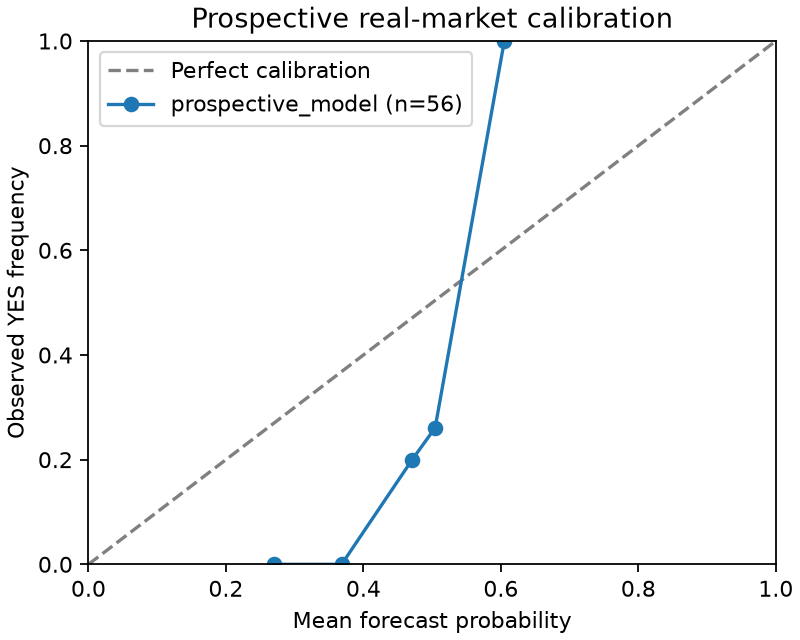

# LLM 预测离线评估 v0

已完成 **56 道真实 Polymarket 二元市场、112 次本地 Codex 预测**的前瞻存档与结算后离线评估。所有输出均早于题目结束，未向模型提供结算答案。

**本批模型逐题输出 p=q，与输入的市场基准完全相同，没有额外预测信号。** Brier 优势为 0；proper / 分数 Kelly 均不建仓，扣费后纸面 PnL 均为 0。这个结果不能证明 LLM 的一般预测能力或可交易优势。

## 真实结果

| 指标 | gpt-6.1-terra / 真实题 |
| --- | ---: |
| 已结算市场数 | 56 |
| 模型 Brier | 0.240393304 |
| 冻结时点市场基准 Brier | 0.240393304 |
| 模型 Log loss（自然对数） | 0.673170327 |
| 市场基准 Log loss | 0.673170327 |
| Brier 优势（市场损失 − 模型损失） | 0.000000000 |
| 95% 到期分块 bootstrap 区间 | [0.000000000, 0.000000000] |
| proper betting 扣费后 PnL | 0.000000 pUSD |
| 1/4 Kelly 扣费后 PnL | 0.000000 pUSD |

优势为正才表示优于基准。本批每题 p=q，因此配对误差逐题相消；[0,0] 是这个恒等关系的退化区间，不能解释为一般能力的精确置信度。56 题只有 5 个到期组，跨组窗口仍重叠，区间仅作本队列的探索性描述。



按 p 分成 10 个等宽桶，空桶为 null。两次采样在所有 56 题上均相同，不能当成 112 个独立样本。

## 队列与时间截断

2026-10-29 UTC，先存档开放市场、再预测、最后关联结算。这样无需把今天获取的已结算条款伪装为历史档案。预先固定 BTC / ETH / SOL / XRP / DOGE / BNB / ZEC / HYPE 的 5m、15m Up/Down 合约，按结束时间及 ID 排序，选出 56 题（每币 7 题；40 道 5m、16 道 15m），未按结果或模型优势筛题。

- 元数据与报价存档：16:47:41–16:48:06 UTC；预设结束余量 10–45 分钟。
- 模型实际调用：16:52:06–16:59:11 UTC；每题 2 次，4 个并发工作线程，112 成功、0 失败。
- 题目结束：17:00、17:05、17:10、17:15、17:20 UTC；最短输出余量 360.714 秒。
- `forecast_at=t` 是每题报价检索完成时间。问题、条款、报价、证据的可用 / 捕获时间都必须 ≤t；本批没有外部新闻证据。
- YES 明确映射到 token 0 的 **Up**，NO 为 Down。问题、规则、目标标签、t、q、报价时间构成提示词白名单；不传市场任意字段、结算结果、事后历史序列或事后条款。
- 调用前和输出后均检查 `end_at`；关联答案时再要求输出早于 `min(end_at,resolved_at)`，不利用链上结算延迟。

q 是 Data V2 `as_of` 在 t 时可见的最新成交观测，**不是输出时可执行盘口**。报价年龄最小 / 中位 / 最大为 0.632 / 16.334 / 5,298.093 秒，4 题超过 5 分钟；预设陈旧上限为 24 小时。预测相对冻结 t 有 276–665 秒延迟。这些报价和延迟限制了纸面收益的现实意义，本批不模拟延迟成交、盘口深度、滑点或真实历史费率。

[Data V2 价格文档](https://docs.polymarket.com/api-reference/markets/get-a-tokens-price-history)区分 `as_of` 与区间序列。开放、未来到期市场的 `as_of` 原始观测可能带 `resolution_seconds=0`，本批保留原始回执及开放状态；已结算历史序列中的零分辨率结算点不得当作历史报价。另保存 56 个 token 的 8,144 个历史点，仅供审计，不补入原始模型上下文。

[Data V2 结算接口](https://docs.polymarket.com/api-reference/markets/get-resolution-state)按 condition 匹配 RESOLVED、真实 `resolved_at` 及 payout。抽样 Gamma 元数据标记为 v1 存量合约，本实验通过 Data API V2 读取历史 token，不验证 V2 执行机制。实网回执为 `[1000000,0]` / `[0,1000000]` 这样的基单位 numerator；只有恰好一项正支付才接受为二元结果，不假定数值一定等于 1；分摊、作废及缺失结算均排除。原始回执保留交易哈希、区块和更新时间。

## 模型与审计

按用户授权调用 NAS 已配置的 `codex exec --model gpt-6.1-terra`，reasoning effort 为 `low`；无需另设 OpenAI API key。官方模型页列出的[知识截止时间为 2026-06-01](https://developers.openai.com/api/docs/models/gpt-6.1-terra)，早于所有题目。

每次在仅含响应 schema 的临时目录非交互运行，使用 read-only / ephemeral 模式，禁用 shell、web、image、code mode、多 agent、skills 与 memories，并拒绝继承 MCP / hooks / profiles。只接受完整 JSONL 完成事件中的数值 p；工具事件、超时、非零退出或非法概率均拒绝，失败只记异常类型。超时会清理并等待该次调用的进程组。

每次预测单独写入 SQLite `forecast_predictions`，保存 model/sample、完整 prompt/context、SHA-256、实际检索 / 开始 / 完成时间、训练截止时间和概率。JSON 导出保留同样的预测证据；归档哈希、逐市场哈希、prompt hash、sample/model 以及结算回执在离线重放中再校验。汇总 CLI usage：651,412 input tokens（其中 443,520 cached）、1,939 output tokens；这是 CLI 用量记录，不是账单金额。

已 rebase 到包含 ARB-7 的 main，共用 `polymarket.PublicDataClient` 的公共 GET 边界、allowlist、统一限流、重试及 compliance guard；首批快照在该合入前经等价固定 GET 路由录制，结算关联在共用数据层完成。仅为本任务公共 GET 客户端显式读取 `ARB_POLYMARKET_PROXY`，HTTPX `trust_env=False`，禁用重定向；不设置全局 HTTP(S)_PROXY，不输出或存储代理值。复用 main 的 `arb_research.compliance`：实际 geoblock 为 blocked=true，trading_allowed=false，交易拒绝保持生效。NAS 用户共享 SQLite 令牌桶 5 req/s、burst 2，并复用通用 API budget；429 / 指定 5xx / 网络错误最多 4 次尝试，遵守有界退避及 Retry-After。没有签名或订单调用。

## 离线重放

离线评分不访问网络、不调用模型，也不需要凭据，只需 Python 3.12 标准库。单测与绘图使用已安装依赖的研究环境。从仓库根目录运行：

```bash
PYTHONPATH=research/src python3.12 -m arb_research.forecast score \
  --input docs/fixtures/llm-forecast-real-settled-v0.json \
  --predictions docs/fixtures/llm-forecast-real-predictions-v0.json \
  --output .state/real-replayed.json
cmp .state/real-replayed.json docs/fixtures/llm-forecast-real-v0.json
PYTHONPATH=research/src research/.venv/bin/python -m unittest discover -s research/tests -p 'test_forecast*.py'
```

图表从保存的校准点重建：

```bash
research/.venv/bin/python research/scripts/plot_forecast.py \
  docs/fixtures/llm-forecast-real-v0.json docs/fixtures/llm-forecast-real-calibration-v0.png
```

实录文件位于 `docs/fixtures/`：`llm-forecast-real-archive-v0.json` 为不含答案的快照；`-predictions-` 为逐次模型记录；`-settled-` 为结算关联；`-history-` 为独立历史回执；`llm-forecast-real-v0.json` 为逐题 p/q/y、指标、配置、校准与排除记录。`research/tests/fixtures/forecast-live-recording.json` 是同次公共 API 真实录制；另保留旧合成契约 fixture，CI 不打外网。

新实验需按环境安装 `uv sync --extra polymarket-validation`，明确执行以下命令；**score 离线重放不会重新发起预测**：

```bash
PYTHONPATH=research/src research/.venv/bin/python -m arb_research.forecast archive-open \
  --output .state/new-open.json --count 56 --min-minutes 15 --max-minutes 45
PYTHONPATH=research/src research/.venv/bin/python -m arb_research.forecast predict-open \
  --input .state/new-open.json --output .state/new-predictions.json --samples 2 --workers 4
# join 只刷新结算；score 需至少 50 道完整题，其他题可保留 pending。
PYTHONPATH=research/src research/.venv/bin/python -m arb_research.forecast join \
  --input .state/new-open.json --predictions .state/new-predictions.json --output .state/new-settled.json
PYTHONPATH=research/src research/.venv/bin/python -m arb_research.forecast history \
  --input .state/new-open.json --output .state/new-history.json
PYTHONPATH=research/src research/.venv/bin/python -m arb_research.forecast score \
  --input .state/new-settled.json --predictions .state/new-predictions.json --output .state/new-results.json
```

## 指标与纸面下注

每市场一个冻结 t，多个样本算术平均；每题等权。Brier=mean((p−y)²)，Log loss 使用自然对数，仅对数计算将 p 截至 [1e−15,1−1e−15]。同题差值 `(q−y)²−(p−y)²` 保持配对，按到期组整体有放回抽取 2,000 次（seed=11），取 2.5% / 97.5% 插值分位数。多次采样不扩充题数。

每题独立 B=100 pUSD≈USD 风险预算，共 5,600，无复利或共享现金复用。proper betting 方向 YES 份额为 `B*s`，`s=2(p−q)`；负方向等价于以 `1−q` 买 NO，并预留完整成本与费用。`PnL=B*s*(y−q)−fee`，fee 为入场成本的 20 bps，预算不足时限制份额。

分数 Kelly 取有优势方向买价 a（YES 为 q、NO 为 1−q），`f=min(0.10,0.25*abs(p−q)/(1−a))`，带方向份额绝对值为 `B*f/(a*(1+fee_rate))`。f 是含费用预算占比，不是费用最优化 Kelly。两者均持有到结算；p=q 时份额及费用都为 0。

## 合成基准与验证

旧的 60 道合成题、两种 mock 模型各采样两次（240 条预测）仍保留在 `llm-forecast-mock-v0.json`，只用于流程回归，不混入真实结果。可用 `forecast demo --count 60 --seed 11 --samples 2 --bootstrap 2000` 重建；其 Brier 为 0.181823368，优势 −0.003347733，CI [−0.012285486,0.007509748]。

最新 main 上完整研究测试：`PYTHONPATH=research/src research/.venv/bin/python -m pytest research/tests -q` 为 **233 passed，44 subtests passed**，15 条依赖弃用警告。真实评分 JSON 离线重放逐字节一致；mock JSON 也逐字节一致。独立只读审查核验了全量时间边界、prompt/context/归档哈希、token 映射、逐次调用记录及结算指标。
